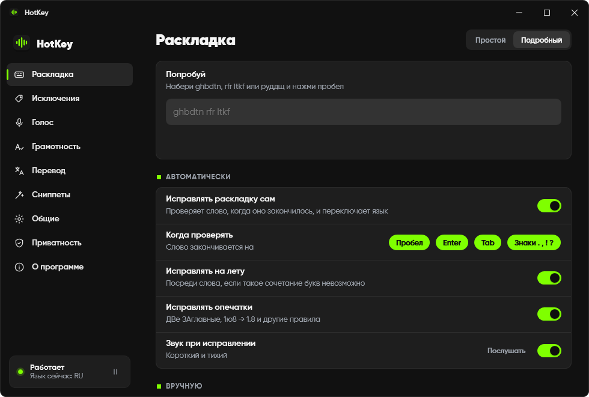
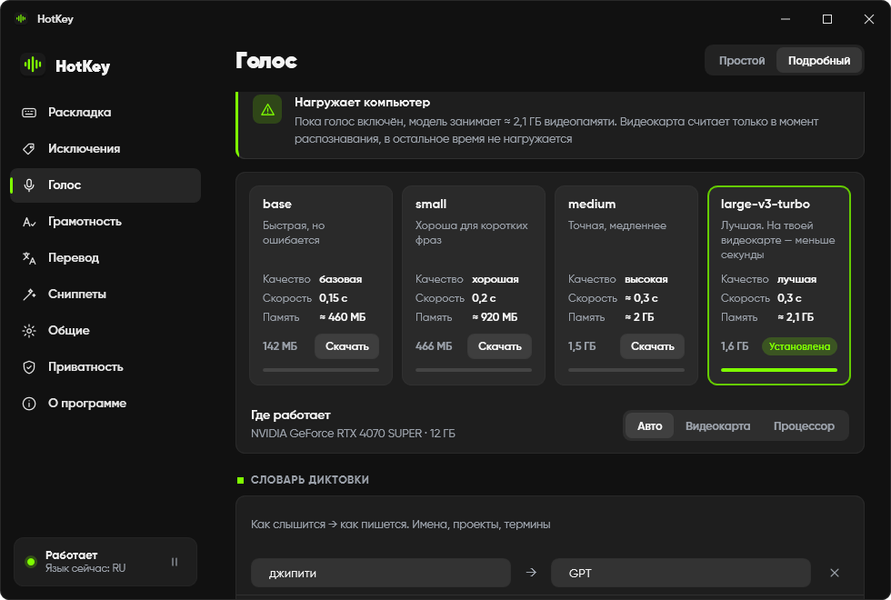
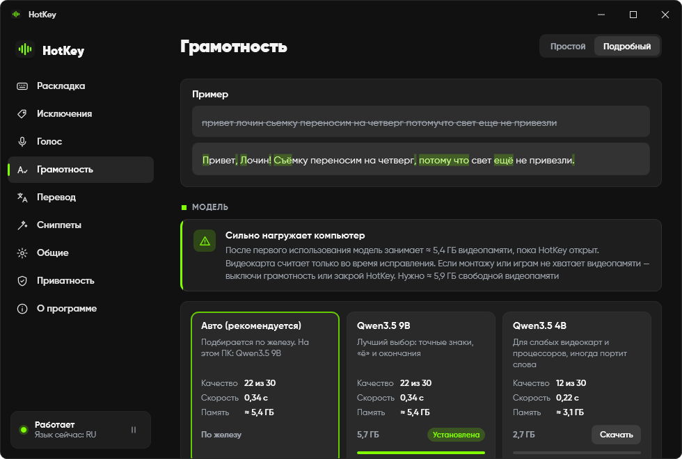
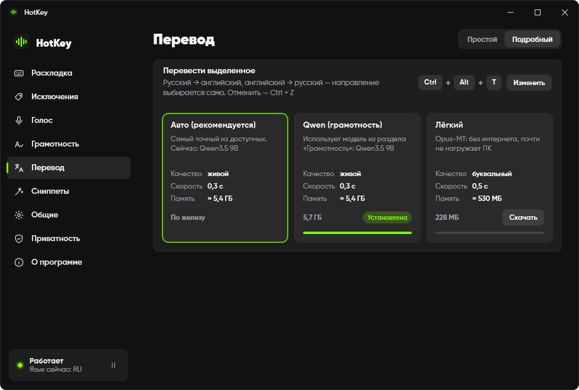
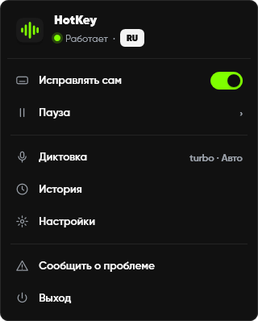

<h1>&nbsp; HotKey</h1>

### Wrong layout? Fixed.

Typed `ghbdtn` instead of `привет`? HotKey quietly fixes it the moment you press space — and switches the language for you. It also types what you say, fixes grammar and translates the selection. Everything runs **on your PC**, and it **never touches your clipboard**.

> ### [⬇&nbsp;&nbsp;Download HotKey for Windows](https://github.com/terison-brmv/hotkey/releases/latest/download/HotKey-Setup.exe)
> Free · Windows 11, 64-bit (Windows 10 not tested yet) · [all versions](../../releases) · [Complaints and suggestions](../../issues/new/choose) · [Читать по-русски](README.ru.md)

 

<table>
  <tr>
    <td width="50%"></td>
    <td width="50%"></td>
  </tr>
  <tr>
    <td align="center"><b>Voice typing.</b> Whisper on your graphics card — under a second.</td>
    <td align="center"><b>Grammar.</b> Commas, typos, «ё» and endings — without rewriting your words.</td>
  </tr>
  <tr>
    <td width="50%"></td>
    <td width="50%"></td>
  </tr>
  <tr>
    <td align="center"><b>Translation.</b> Select text, press Ctrl + Alt + T.</td>
    <td align="center"><b>Tray.</b> Current language, pause, settings.</td>
  </tr>
</table>

---

## Why it exists

Everyone who writes in Russian and English knows it: half a sentence comes out as `rfr ltkf`, you notice it too late, erase, switch the layout, type again. Classic layout switchers fix this, but they do it through the clipboard — and quietly overwrite whatever you copied a minute ago.

HotKey fixes the word **in place**: it erases it and types the right one directly, so your clipboard stays exactly as you left it.

## The ten-second tour

1. **Just type.** A word in the wrong layout is fixed when you press space, Enter or Tab, and the language switches.
2. **HotKey missed one?** Press **Win + Shift** — the last word (or the selection) goes to the other layout.
3. **Fixed something it shouldn't have?** Press **Win + Shift** right away — the word comes back, and HotKey offers to remember it as an exception.

## Hotkeys

All of them can be changed in Settings.

| Keys | What it does |
|---|---|
| **Win + Shift** | Fix the last word or the selection. Right after an auto-fix — undo it |
| **Win + Ctrl** | Fix caps: `HELLO. HOW ARE YOU` → `Hello. How are you` |
| **Ctrl + Alt** | Make the selection literate: punctuation, typos, «ё», endings |
| **Ctrl + Alt + T** | Translate the selection RU ↔ EN, in place |
| **Hold right Alt** | Voice typing: hold, speak, release |
| **Ctrl + Alt + V** | Paste the last dictation |
| **Ctrl + Alt + Space** | Pick a snippet |

## What's inside

| | |
|---|---|
| **Layout fixing** | Detection ported from [Keyboop](https://github.com/iffuno/keyboop): 160 000+ word dictionaries and letter statistics. On a 56 000-word test it ruins a correctly typed word in 0.07 % of cases. Emoticons, numbers, links, abbreviations and your exceptions are left alone |
| **Fix while typing** | Impossible letter combinations are fixed mid-word |
| **Typos** | `TWo CApitals`, `1ю8 → 1.8` and a table of common typos |
| **Voice typing** | Whisper turbo on the graphics card (≈ 0.3 s per phrase) or a lighter model on the processor. A dictionary «how it sounds → how it's written» for names and terms. Drop an audio or video file to get text with timecodes |
| **Grammar** | Qwen3.5 9B fixes punctuation, typos, «ё» and endings. A guard rolls back any edit that changes a word instead of fixing its spelling |
| **Translation** | Lively translation by the grammar model, or a light Opus-MT model that works on any PC |
| **Snippets** | Type an abbreviation and space — get the phrase. Layout and case don't matter |
| **Your hardware, your choice** | HotKey detects the graphics card, free video memory and processor speed and picks models that fit. Every model card shows quality, speed and memory |
| **Safe by default** | Password fields, terminals and full-screen games are skipped. Pause for 15 minutes, an hour or until restart |
| **Updates** | Checks this page once a day and installs a new version while the PC is idle. Can be switched off |

## Heavy parts are optional

Layout fixing is light: about 100 MB of memory and practically no CPU. Voice, grammar and translation use local neural networks. They are off until you download a model, and HotKey tells you honestly how much they load the PC:

| Model | Size | On a graphics card | Without one |
|---|---|---|---|
| Whisper turbo (voice) | 1.6 GB | ≈ 2.1 GB video memory, 0.3 s | not recommended — use small or base |
| Qwen3.5 9B (grammar, translation) | 5.7 GB | ≈ 5.4 GB video memory, 0.3 s | ≈ 2.5 s on a fast processor, 16 GB RAM |
| Qwen3.5 4B | 2.7 GB | ≈ 3.1 GB video memory, 0.2 s | ≈ 1.3 s, 12 GB RAM |
| Opus-MT (light translator) | 228 MB | — | ≈ 0.5 s on any PC |

## Private by design

No accounts, no analytics, no ads. What you type and say stays on your PC. HotKey goes online only to download a model you asked for, and to check for updates. Details: [PRIVACY.md](PRIVACY.md).

## Install

1. [Download `HotKey-Setup.exe`](https://github.com/terison-brmv/hotkey/releases/latest/download/HotKey-Setup.exe) and run it. No administrator rights needed.
2. Windows may show **"Windows protected your PC"** — the installer is not code-signed yet. Click **More info → Run anyway**.
3. HotKey appears in the tray next to the clock. The welcome window walks you through hotkeys and models.

Uninstall: **Settings → Apps → HotKey**. You'll be asked whether to keep your settings and models.

## Feedback

Found a bug or have an idea? Write it right here, in [Issues](../../issues/new/choose) — the **Complaints and suggestions** button in HotKey (Settings → About, Updates or the tray menu) opens this page. Russian or English — both are fine.

## Author and license

Made by [terison-brmv](https://github.com/terison-brmv). Free for personal use — see [LICENSE](LICENSE). HotKey is built on open-source work listed in [THIRD-PARTY-NOTICES.md](THIRD-PARTY-NOTICES.md).
