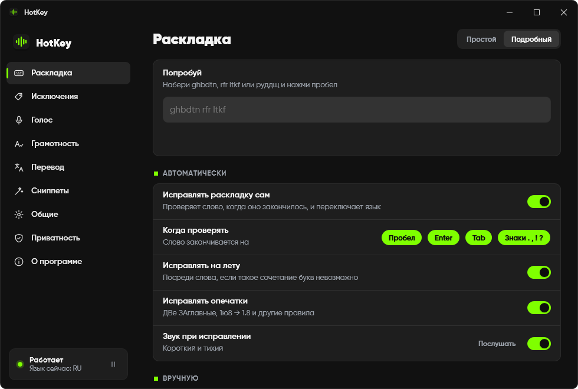

<h1>&nbsp; HotKey</h1>

### Не та раскладка? Уже исправлено.

Набрал `ghbdtn` вместо `привет`? HotKey тихо исправит слово, как только нажмёшь пробел, и сам переключит язык. А ещё он печатает голосом, исправляет грамотность и переводит выделенный текст. Всё работает **на твоём компьютере** и **не трогает буфер обмена**.

> ### [⬇&nbsp;&nbsp;Скачать HotKey для Windows](https://github.com/terison-brmv/hotkey/releases/latest/download/HotKey-Setup.exe)
> Бесплатно · Windows 11, 64 бит (на Windows 10 пока не проверяли) · [все версии](../../releases) · [что нового](CHANGELOG.md) · [Жалобы и предложения](../../issues/new/choose) · [English](README.md)

 

## Зачем

Каждый, кто пишет по-русски и по-английски, знает: полфразы выходит как `rfr ltkf`, замечаешь поздно, стираешь, переключаешь раскладку, набираешь заново. Обычные переключатели это чинят, но через буфер обмена — и тихо затирают то, что ты скопировал минуту назад.

HotKey исправляет слово **на месте**: стирает его и печатает правильное напрямую, а буфер обмена остаётся каким был.

## Как пользоваться

1. **Просто печатай.** Слово в чужой раскладке исправится на пробеле, Enter или Tab, язык переключится.
2. **HotKey пропустил слово?** Нажми **Win + Shift** — последнее слово (или выделенное) уйдёт в другую раскладку.
3. **Исправил зря?** Сразу нажми **Win + Shift** — слово вернётся, а HotKey предложит запомнить его как исключение.

## Горячие клавиши

Любую можно поменять в настройках.

| Клавиши | Что делает |
|---|---|
| **Win + Shift** | Исправить последнее слово или выделенное. Сразу после автоисправления — отменить его |
| **Win + Ctrl** | Исправить капс: `ПРИВЕТ. КАК ДЕЛА` → `Привет. Как дела` |
| **Ctrl + Alt** | Сделать выделенное грамотным: знаки, опечатки, «ё», окончания |
| **Ctrl + Alt + T** | Перевести выделенное RU ↔ EN, на месте |
| **Зажать правый Alt** | Голосовой набор: зажал, сказал, отпустил |
| **Ctrl + Alt + V** | Вставить последнюю диктовку |
| **Ctrl + Alt + Пробел** | Выбрать сниппет |

## Что умеет

| | |
|---|---|
| **Исправление раскладки** | Детектор перенесён из [Keyboop](https://github.com/iffuno/keyboop): словари на 160 000+ слов и статистика буквосочетаний. На проверке из 56 000 слов портит правильно набранное слово в 0,07 % случаев. Смайлики, цифры, ссылки, аббревиатуры и твои исключения не трогает |
| **Исправление на лету** | Невозможные сочетания букв чинятся прямо посреди слова |
| **Опечатки** | `ДВе ЗАглавные`, `1ю8 → 1.8` и таблица частых опечаток |
| **Голосовой набор** | Whisper turbo на видеокарте (≈ 0,3 с на фразу) или модель полегче на процессоре. Словарь «как слышится → как пишется» для имён и терминов. Перетащи аудио или видео — получишь текст с таймкодами |
| **Грамотность** | Qwen3.5 9B расставляет знаки, правит опечатки, «ё» и окончания. Защита откатывает правку, если модель поменяла слово, а не его написание |
| **Перевод** | Живой перевод моделью грамотности или лёгкая модель Opus-MT, которая работает на любом ПК |
| **Сниппеты** | Набрал сокращение и пробел — получил фразу. Раскладка и регистр не важны |
| **Под твоё железо** | HotKey сам определяет видеокарту, свободную видеопамять и скорость процессора и подбирает модели. В карточке каждой модели — качество, скорость и память |
| **Безопасно** | Поля паролей, терминалы и полноэкранные игры пропускаются. Пауза на 15 минут, час или до перезапуска |
| **Обновления** | Раз в день проверяет эту страницу и ставит новую версию, пока компьютер простаивает. Можно выключить |

## Тяжёлое — по желанию

Исправление раскладки лёгкое: около 100 МБ памяти и почти ноль нагрузки. Голос, грамотность и перевод работают на локальных нейросетях. Они выключены, пока ты не скачаешь модель, а HotKey честно пишет, насколько они нагружают ПК:

| Модель | Размер | На видеокарте | Без видеокарты |
|---|---|---|---|
| Whisper turbo (голос) | 1,6 ГБ | ≈ 2,1 ГБ видеопамяти, 0,3 с | не советуем — лучше small или base |
| Qwen3.5 9B (грамотность, перевод) | 5,7 ГБ | ≈ 5,4 ГБ видеопамяти, 0,3 с | ≈ 2,5 с на быстром процессоре, 16 ГБ ОЗУ |
| Qwen3.5 4B | 2,7 ГБ | ≈ 3,1 ГБ видеопамяти, 0,2 с | ≈ 1,3 с, 12 ГБ ОЗУ |
| Opus-MT (лёгкий переводчик) | 228 МБ | — | ≈ 0,5 с на любом ПК |

## Приватность

Без аккаунтов, аналитики и рекламы. То, что ты печатаешь и говоришь, остаётся на ПК. В интернет HotKey выходит только чтобы скачать модель по твоей кнопке, и проверить обновления. Подробно: [PRIVACY.md](PRIVACY.md).

## Установка

1. [Скачай `HotKey-Setup.exe`](https://github.com/terison-brmv/hotkey/releases/latest/download/HotKey-Setup.exe) и запусти. Права администратора не нужны.
2. Windows может показать **«Система Windows защитила ваш компьютер»** — у установщика пока нет цифровой подписи. Нажми **Подробнее → Выполнить в любом случае**.
3. HotKey появится в трее рядом с часами. Окно приветствия расскажет про клавиши и модели.

Удаление: **Параметры → Приложения → HotKey**. Программа спросит, оставить ли настройки и модели.

## Жалобы и предложения

Нашёл ошибку или есть идея? Напиши прямо здесь, в [обращениях](../../issues/new/choose) — кнопка **«Жалобы и предложения»** в HotKey (Настройки → О программе, Обновления или меню трея) открывает эту страницу.

## Автор и лицензия

Автор — [terison-brmv](https://github.com/terison-brmv). Бесплатно для личного использования — см. [LICENSE](LICENSE). HotKey построен на открытых проектах, они перечислены в [THIRD-PARTY-NOTICES.md](THIRD-PARTY-NOTICES.md).
